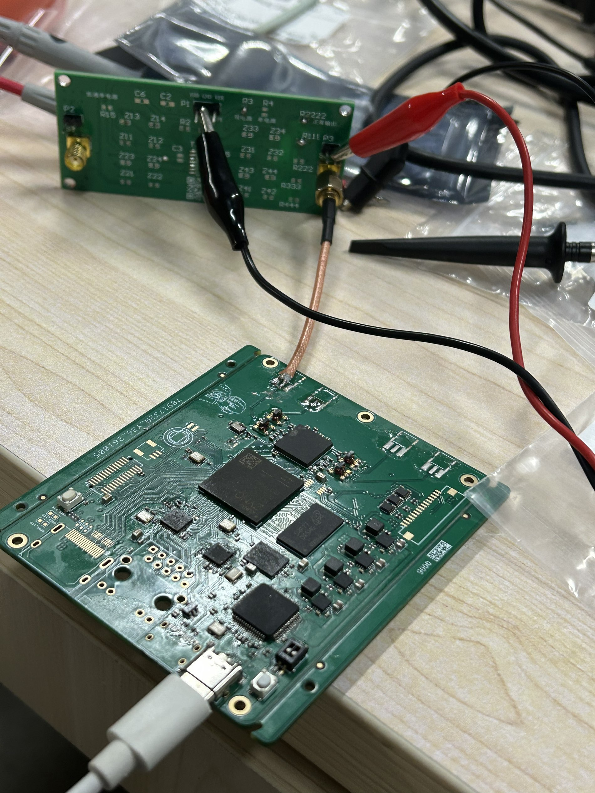
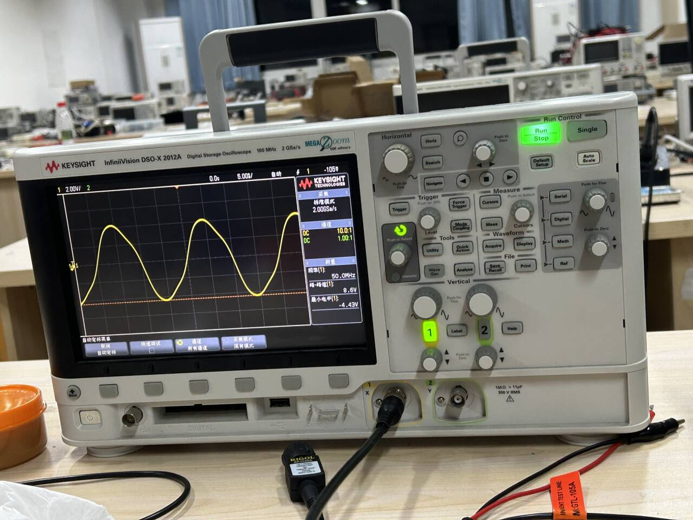
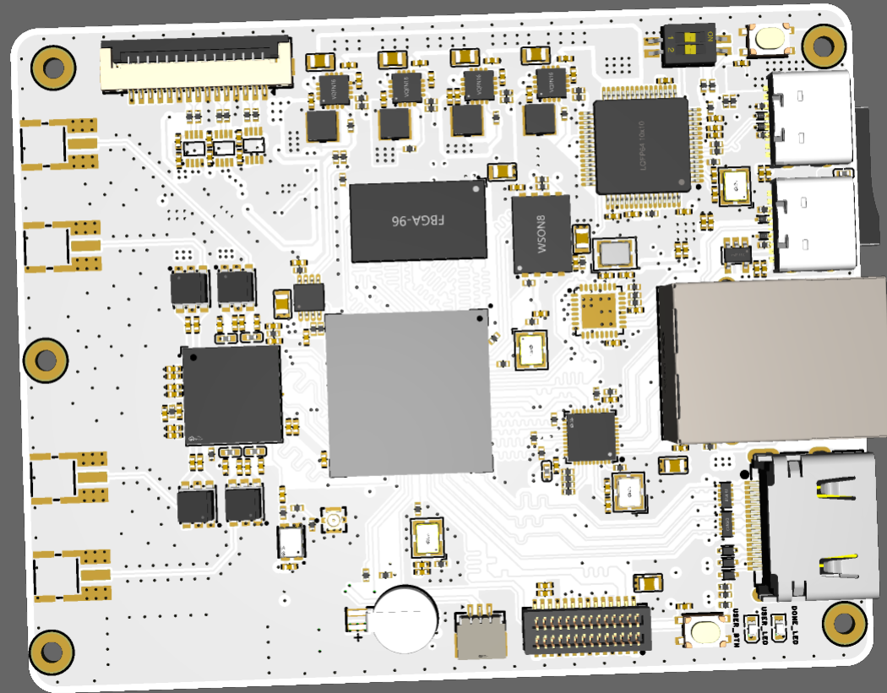

# FreeSdr Hardware

FreeSdr 硬件项目仓库，存放硬件原理图、PCB 文件和调试记录。

本工程使用嘉立创 EDA 原生格式制作，可使用免费券打样；阻抗设置为 `3323`。

## 硬件文件

- `FreeSdr_V0.8.epro2`：嘉立创 EDA 工程文件
- `SCH_FreeSdr_sch.pdf`：原理图 PDF

## 待改进项

初版硬件后续需要检查或改进以下内容：

1. 调整 UART 线序（当前接反）
2. 调整 Flash 线序（当前接反）
3. 处理螺丝接地和开窗屏蔽
4. 修改射频头接口
5. 评估是否更换 NCP59801CMLADJTCG（器件不易购买）

## 调试记录

- USB3320 无法识别芯片 ID，怀疑与焊接有关
- HDMI 尚未测试
- MIPI 尚未测试
- GPS 尚未测试
- TF 卡尚未测试

### 测试照片

射频座封装存在问题，因此暂时剥开同轴线进行测试。

测试使用普通鳄鱼夹。示波器探头仍设置为 `×10`，当时未调整回来。

### PCB

